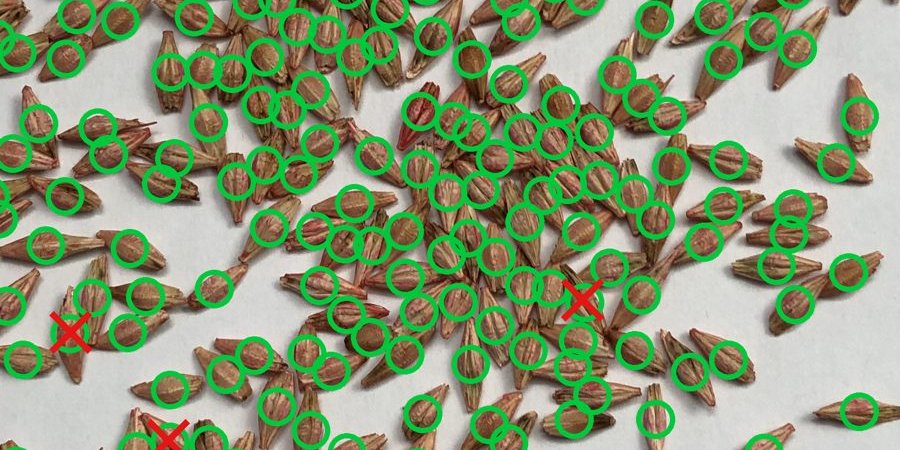

# Tausendkorn

Team **Goldpfanne** (Leon Böhlau, Jonas Heinke) · Tausendkorn-Hackathon, Smart Farming Lab,
Universität Leipzig, 27.–28.10.2026.

License: to be decided before publication

Hackathon-Prototyp: Die Zählung kann Körner übersehen oder doppelt zählen. Bekannte
Fehler an Kachelnähten, im Prüfdurchgang und bei der Blatterkennung sind im
[Engineering-Review vom 28.10.](docs/reviews/2026-10-28_astra_roadmap.md) dokumentiert.
Die hier genannten Benchmark-Commits (insbesondere `d2ced75` und `44a553a`) beziehen
sich auf das private Entwicklungsarchiv, nicht auf die frische Historie dieses Repos.

**Live ansehen:** <https://goldpfanne-tausendkorn.pages.dev/> (Demo mit gespeicherten Ergebnissen,
Pitch unter [/pitch/](https://goldpfanne-tausendkorn.pages.dev/pitch/)).

Ein Handyfoto einer zufällig gegriffenen Handvoll Körner auf A4 genügt: Ein Vision-Modell
markiert **jedes einzelne Korn**, die App zeigt die Zahl mit Fehlerband und die unsicheren
Stellen zum Nachprüfen. Mit Probengewicht und Keimfähigkeit rechnet sie
**Tausendkorngewicht** und **Aussaatmenge in kg/ha** für die Drillmaschine, inklusive
Abdrehprobe.



## Ergebnisse auf einen Blick

Die finale Pipeline v1.0.2 wurde einmal auf 30 Holdout- und 6 Testbildern gemessen. Ein früherer Holdout-Lauf mit 11 Bildern wurde nach Fehlerkorrekturen verworfen; der Holdout ist daher nicht vollständig unberührt. Die Splits teilen Sessions und liefern Within-Session-Ergebnisse. Holdout-Commit `d2ced75`, Test-Commit `44a553a`, gleicher Pipeline-Fingerprint `422967946cbd`. Regeln: [`docs/PROTOCOL.md`](docs/PROTOCOL.md).
Fehler = gezählt − Label, MAE = mittlerer absoluter Fehler in Körnern.

| Satz | Bilder | Gemini-4-Argon-Pipeline | YOLO11s, dieselben Bilder |
|---|---|---|---|
| Holdout, gleiche Aufnahmetage wie Training (170–482 Körner) | 30 von 40 (Hafer, Gerste, Weizen) | **MAE 5,9** (1,85 %) | MAE 3,2 |
| Test `count_1000`, anderer Tag, Roggen neu (1000 Körner) | 6 von 85, alle 5 Arten | **MAE 15,8** (1,58 %) | MAE 12,5 |

- Holdout ist **within-session**: unsere Splits trennen nach Aufnahme-Schritten, nicht nach
  Session. Der Test vom anderen Tag ist der unabhängigere Check, aber nur 6 Bilder.
- Die Hartweizen-Abweichung ist ungeklärt: Argon zählt 942, YOLO auf demselben Foto 948; über 17 Fotos zählt YOLO 911–976. Gemeinsame Unterzählung verdeckter Körner und eine Abweichung der Probe vom Label sind nicht ausgeschlossen. Ein fehlender 50er-Becher ist nur eine Hypothese. Gewertet wird unverändert gegen 1000; Test-MAE 15,8 bei n=6. ([`docs/befund/DURUM_COUNT_1000.md`](docs/befund/DURUM_COUNT_1000.md))
- YOLO11s wurde separat offline verglichen und ist nicht in die App integriert. Auf denselben 30 Holdout-/6 Testbildern: MAE 3,2/12,5; auf allen 85 Testbildern: MAE 25,4. Laufzeit auf einer RTX 3070 typischerweise 0,4 s pro Bild.
- Gemessene API-Kosten pro Foto: Holdout 0,12–0,56 US-Dollar, Test 0,61–0,79 US-Dollar; Mittelwerte 0,31 bzw. 0,66 US-Dollar. Dauer 1–2 Minuten pro Probe.

Alle Bilder mit Overlays zum Durchklicken: [`results/index.html`](results/index.html).
Vollständige Zahlen: [`docs/RESULTS.md`](docs/RESULTS.md).

## Schnellstart (ohne Kosten)

Voraussetzungen: Python **3.12** und [uv](https://docs.astral.sh/uv/).
Nach Veröffentlichung die von Jonas freigegebene Repository-URL einsetzen:

```bash
git clone <PUBLIC_REPOSITORY_URL> tausendkorn-public
cd tausendkorn-public
uv sync --locked
uv run python -m app --mock
```

Dann <http://localhost:8000> öffnen. Das iPad im selben WLAN koppelt sich über den
QR-Code auf dieser Seite. Der Mock-Modus zeigt ein gespeichertes Ergebnis, braucht keinen
Schlüssel und kostet nichts. Anderer Port: `--port 8080`. Erreicht das iPad die Seite
nicht, Python in der Windows-Firewall fürs private Netz freigeben.
**So sieht die App aus:** [`docs/app/screens/`](docs/app/screens/README.md) (8 Mock-Screenshots).
Verlaufsbilder mit Kopplungsdaten wurden entfernt. Bedienung: [`docs/app/UX.md`](docs/app/UX.md).

## Echter Zähllauf

Braucht einen Gemini-API-Key (Projekt mit Billing). Er liegt im Schlüsselbund des
Betriebssystems, nie in Dateien.

```bash
uvx keyring set tokenkit GEMINI_API_KEY
uv run python -m tausendkorn.pipeline foto.jpg     # ein Foto zählen
uv run python -m app                               # App mit echter Zählung
```

Datensatz für Messungen und Overlays (≈ 9 GB, nicht im Repo):

```bash
uvx --from huggingface_hub hf download SmartFarmingLab/corn1000 --repo-type dataset --local-dir data/corn1000
```

Die Evaluation benötigt diesen lokalen Datensatz; Messregeln und Einschränkungen:
[`docs/PROTOCOL.md`](docs/PROTOCOL.md). Optionale GPU-Experimente verwenden
`uv sync --locked --group gpu` und die Module in `src/tausendkorn/gpu/`; die
Checkpoint-Gewichte werden [vorerst nicht verteilt](models/README.md).

Die statische Site wird nach dem Datensatz-Download lokal erzeugt (keine API-Kosten):

```bash
uv run python scripts/build_site.py
uv run python -m http.server 8020 --directory site
```

Generierte Site-Bilder und Beispieldaten sind absichtlich ignoriert; direkt nach dem
Klonen fehlen sie. Das eigenständige Web-Deck liegt in `pitch/web/`.

## So funktioniert es

1. **Adaptive Kacheln**: das Blatt wird nach Korndichte in Ausschnitte mit höchstens ~15
   Körnern geschnitten.
2. **Gemini 4 Argon** setzt pro Ausschnitt einen Punkt pro Korn (ISO 520: kein Bruch,
   keine Spreu) und meldet seine Konfidenz.
3. **Abgleich** der überlappenden Ränder, doppelte Punkte fallen weg.
4. **Prüfdurchgang**: unsichere Ausschnitte sieht das Modell mit seinen Markierungen noch
   einmal und korrigiert.
5. **YOLO11s** als zweiter, lokal trainierter Zähler: separat offline verglichen, nicht in die
   App integriert ([`docs/ZWEITMEINUNG.md`](docs/ZWEITMEINUNG.md)). Gewichte werden
   [vorerst nicht verteilt](models/README.md); Hashes und Messwerte bleiben erhalten.
   Nach der Abgabe wurde ein Blur-Modell trainiert und nur auf dev gemessen
   ([`docs/RESULTS.md`](docs/RESULTS.md)); es gehört nicht zum eingefrorenen Benchmark.

Programmierschnittstelle für andere Werkzeuge: REST unter `/api/v1` und ein MCP-Server für
KI-Agenten (`uv run python -m app.mcp_server`); Zählungen brauchen eine Freigabe in der App.
Details und offene Punkte: [`docs/app/API.md`](docs/app/API.md).

## Grenzen (ehrlich)

1. **Fehlerband**: ± 3 % aus der Holdout-Messung. Darin liegen 26 von 30 Holdout- und 5 von 6
   Testfotos (Median 1,7 %, 90 % der Fotos innerhalb ± 3,1 %).
   An anderen Aufnahmetagen kann der Fehler größer sein.
2. **Echte Zählung aus der App**: Zwei erfolgreiche Einzeltests, keine Messreihe: PC-Upload 488 statt 493 Körner, 47 s, 0,39 US-Dollar; eigenes iPad-Foto über Hotspot 233 Marken, 54 s, 0,36 US-Dollar; dabei per Sichtprüfung zwei Doppelmarkierungen, eine unabhängige Sollzählung fehlt. ([Screenshots](docs/app/screens/echt/)). Fehlerfälle
   wie eine unvollständige Zählung sind nur mit simulierten Fehlern getestet, nicht live.
3. **„Prüfstellen bestätigt“ heißt nicht „Zahl richtig“**: Die Prüfstellen kommen vom selben
   Modell. Körner, die es sicher übersieht, werden nicht markiert.
4. **Foto-Vorprüfung ist grob** (helle Fläche, Schärfe, Häufchen; keine A4-Formprüfung),
   eingestellt auf 24 Fotos.
5. **Nachprüfen in dichten Haufen**: Die Vorschau hat 2000 px, Tippen kann dort mehrdeutig sein.
6. **TKG der Partie**: Gewogen wird die ganze Probe, wie sie ist, mit Bruch und Spreu; gezählt
   werden nur ganze Körner. Das ergibt das Gewicht der Partie pro 1000 Körner, also genau das,
   was die Drillmaschine ausbringt (ein Labor-TKG ohne Besatz liegt etwas niedriger). Grenze:
   Die Probe muss repräsentativ sein und vollständig gewogen werden.
7. **Betrieb**: nur im WLAN mit dem Laptop, kein Offline-Modus, kein HTTPS, keine
   Admin-PIN; eine Zählung gleichzeitig, ca. 1–3 Minuten. Ohne Admin-PIN vertraut der
   Laptop sich selbst: Die Freigabe bezahlter Zählungen gilt für Geräte im WLAN und für
   Agenten, die nur Token bzw. MCP-Tools haben; ein lokaler Prozess (auch ein lokal
   laufender Agent mit eigenem HTTP-Zugriff) kann ohne Freigabe zählen lassen und den
   Kopplungscode lesen. Eine Admin-PIN ist ein offener Verbesserungsvorschlag.
8. **Partie** ist Freitext, ohne Warnung bei großer Streuung zwischen Proben.
9. **Saatmengen-Vorgaben** sind nur teilweise mit Quellen geprüft.
10. **iPad**: auf dem echten iPad einmal getestet (s. Punkt 2), sonst in der Emulation.
11. **Fotoformat und Netz**: iPhone-HEIC wird nicht gelesen (JPG oder PNG nutzen); die
    Zählung braucht Internet.

Mehr dazu: [`docs/app/UX.md`](docs/app/UX.md),
[`docs/app/SAATGUTRECHNER.md`](docs/app/SAATGUTRECHNER.md),
[`docs/app/ROADMAP.md`](docs/app/ROADMAP.md), [`docs/PROBLEMFAELLE.md`](docs/PROBLEMFAELLE.md).

## Ordner

| Ordner | Inhalt |
|---|---|
| [`app/`](app/) | Feld-App (FastAPI + HTML), läuft auf dem Laptop, iPad per WLAN |
| [`src/tausendkorn/`](src/tausendkorn/) | Zählpipeline, Evaluation, Overlays; `gpu/` für YOLO11s und GeCo2 |
| [`results/`](results/README.md) | Ergebnis-Archiv: Vorhersagen, Overlays, Galerie `index.html` |
| [`docs/`](docs/README.md) | Dokumentation: Aufgabe, Protokoll, Ergebnisse, App, Befunde |
| [`splits/`](splits/) | Bildlisten für dev, holdout, train (SHA-256 im Protokoll) |
| [`design/`](design/README.md) | UI-Studien und gewähltes UI-System „Labor“ |
| [`pitch/`](pitch/) | Pitch-Deck und Assets |
| [`hardware/`](hardware/) | Konzepte für Foto-Station und Kornwaschpfanne (Renders, STL) |
| [`wissensbank/`](wissensbank/README.md) | Hintergrundwissen und Werkzeugkasten |
| [`notebooks/`](notebooks/) | Explorative Notebooks |
| `runs/` | Arbeitsstände der Läufe (größtenteils nicht im Repo) |

## Team

**Goldpfanne**: Leon Böhlau, Jonas Heinke, mit Claude-Sessions (Anthropic) und
Astra (OpenAI) als Gegenprüfung.

## Lizenz und Datenquelle

Code-Lizenz: Entscheidung von Jonas vor Veröffentlichung ausstehend (AGPL-3.0-only
oder MIT; Rechte an Drittkomponenten bleiben separat zu klären). Es gibt noch keine
LICENSE-Datei und keine allgemeine Freigabe zur Nutzung des Codes.

Fotos und dataset-abgeleitete Dateien: corn1000 — Smart Farming Lab, Universität
Leipzig, **CC BY-NC 4.0**. [Lizenzgrenze und vollständiges Provenienzmanifest](DATA_LICENSE.md).
