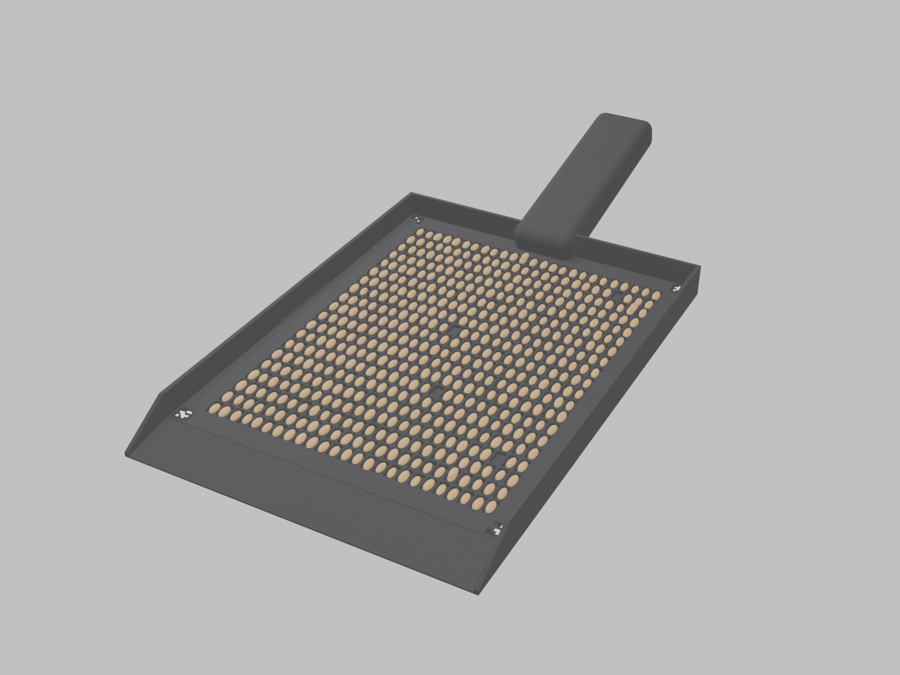

# Historical counting-pan concept

This dated experiment selects a fixed number of kernels in moulded wells. It was
rejected for the field workflow because selection can bias the random sample.
See the historical [concept](BRIEF.md) and [engineering review](ASTRA_REVIEW_v0.md).

Build scripts and STL manufacturing outputs are retained. Generated BLEND exports
contained private absolute paths and are excluded, alongside redundant views and
simulation/render exports. The successor concepts are
[KornKlapp](../station/README.md) and the [swirling pan](../waschpfanne/README.md).
