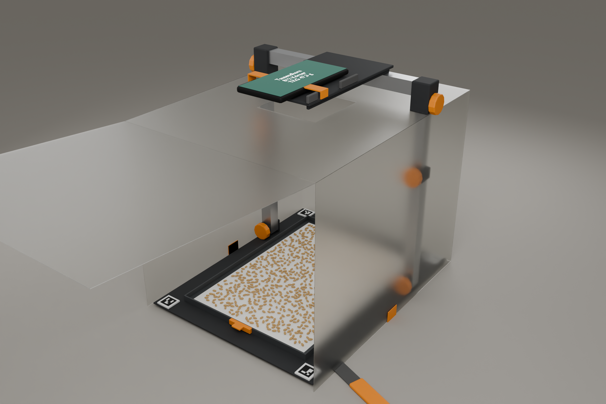

# KornKlapp: Fotostation für die Handvoll-Probe

Physisches Begleitwerkzeug zur Tausendkorn-App. Der Kernablauf bleibt unverändert: **eine
zufällige Handvoll, komplett auf A4 gezählt**. KornKlapp sorgt dafür, dass diese Handvoll
zusammenbleibt, auseinandergestrichen und gleich fotografiert wird. Danach geht sie ohne
Verlust auf die Waage. Es gibt keine Mulden, Siebe oder Auswahl, also auch keinen
Größen-Bias. Die frühere 1000-Mulden-Pfanne (`../pfanne/`) ist aus genau diesem Grund
verworfen.



Weitere Renderansichten sind aus Größengründen nicht enthalten; mit dem Build-Skript regenerierbar.

## Designentscheidung (Astra, GPT-6 Astra via Codex, 27.10.2026)

Die Designantwort liegt in
[`ASTRA_DESIGN.md`](ASTRA_DESIGN.md). Astra hat drei Konzepte verglichen:

| Konzept | Hebel | Prototyp / Stück bei 1000 | Hauptrisiko |
|---|---|---|---|
| **A. KornKlapp-Feldschale**: A4 in Schale mit Rand, Silikonspatel, Klappgalgen | Kornkontakte, Perspektive, Unschärfe, Verlust | 55–90 € / 25–38 € | Auseinanderstreichen kostet Zeit; dichter Hafer bleibt schwierig |
| B. Kurbel-Rüttelplatte (1–2 mm, 2–4 Hz, ohne Batterie) | Kontakte, Verlust | 85–140 € / 40–65 € | Randanhäufung, Entmischung nach Größe; Wirkung unbelegt |
| C. Faltbare Tageslichthaube | Schatten, Spiegelungen, Wind | 20–40 € / 8–16 € | Trennt keine Körner und sichert den Transfer nicht |

**Astras Empfehlung:** A plus die abnehmbare Haube aus C. A geht den größten Fehlerhebel,
aneinanderliegende Körner, direkt und sichtbar an. Die Rüttelplatte müsste erst durch viele
Versuche beweisen, dass sie ihre Komplexität wert ist.

> Pitch-Satz (Astra): „Eine zufällige Handvoll aufs Blatt, fotografieren, wiegen –
> KornKlapp hält die Probe zusammen und macht daraus mit Tausendkorn Ihre Aussaatmenge.“

Warum besser als ein loses A4-Blatt (Astra):
- **Weniger Kornkontakte:** gezielt auseinanderstreichen, ohne Größen auszuwählen.
- **Verlässlichere Fotos:** feste Kameraposition, A4 immer ganz im Bild, diffuseres Licht.
- **Dieselbe Probe bis zur Waage:** Rand, Ausgießer und Becher halten sie zusammen.

Astra weist selbst darauf hin, dass die Genauigkeitsgewinne bisher Hypothesen sind: Vor
jeder Aussage im Pitch dieselbe Handvoll auf bloßem Papier und in KornKlapp vergleichen.

## Maße (mm), Ursprung = Mitte des A4-Blatts

| Teil | Geometrie | Material |
|---|---|---|
| Basisplatte | 300 × 380 × 2, vier Silikonfüße Ø20 × 4 | Alu, anthrazit matt |
| Probenkassette (herausnehmbar) | außen 230 × 317, Boden 2, Rand 8 hoch × 2 dick, innen 226 × 313 (Astra: 212 × 299, siehe Abweichungen) | PP dunkelgrau, kein Weiß ums Blatt |
| A4 auf Haftunterlage | 210 × 297, Ecken frei | Papier weiß |
| Ausgießöffnung + Stopfen | 40 breit × 8 hoch, vorne mittig; Stopfen mit Zuglasche | PETG orange |
| Marker | 4 × ArUco DICT_4X4_50, IDs 0–3 im Uhrzeigersinn ab oben links, 18 mm schwarz + 3 mm weiße Ruhezone, auf Papierebene unterlegt; Mitten (±131, ±176) | Etikett matt |
| Galgen | 2 Pfosten bei x = ±140, y = +80; Außenrohr 20 × 20 × 1,5, 200 lang; Innenrohr 16 × 16 × 1,5, 220 lang; Querholm 280 × 20 × 20; M5-Klemmen mit Ø30-Knäufen | Alu |
| Klappgelenk | M5-Stift, Wangen 5 dick, Bohrung 5,3; klappt nach vorn (–y), 90°-Anschlag | PETG |
| Handyauflage | 115 × 200 × 4, Rippen 6 × 4, offene Aussparung 65 × 65 um die Kamera; Linse 340 über dem Papier; 15 mm Halteband, gepolsterte Anschläge | PETG anthrazit |
| Haube | 0,5 mm PP transluzent, 312 × 392 × 300, Dach mit Öffnung 100 × 100, Front klappt hoch, Zuglaschen 25 mm | PP weiß transluzent |
| Ausgießer | aufsteckbar, 40 → 30 breit, 50 lang, offene Rinne | PETG orange |
| Spatel | Griff 100 × 22 × 6, Silikonblatt 60 × 20 × 1, runde 4-mm-Spitze | PETG + Silikon |
| Becher | Ø74 × 70, ca. 250 ml | PP klar |

Kamerageometrie (Astra): 26-mm-Hauptkamera bei 340 mm erfasst etwa 339 × 453 mm im
4:3-Hochformat, also die ganze Basis mit Rand. Galgen 320–380 mm verstellbar, kein
Digitalzoom, Ultraweitwinkel nicht benutzen (verschenkt Auflösung). Render 03 zeigt genau
diese Kamera.

### Abweichungen vom Spec (für das Modell)

- Marker von (±125, ±170) nach **(±131, ±176)** verschoben, damit die 24-mm-Sockel nicht auf
  dem Kassettenrand (außen x = 115) liegen.
- Haube von 300 × 380 auf **312 × 392** vergrößert, damit die Pfosten innen bleiben; das
  Dach hat Aussparungen für die Pfosten.
- Innenmaß der Kassette folgt aus Außenmaß minus Rand (226 × 313). Astras 212 × 299 mit
  1 mm Spalt widerspricht 230 außen bei 2 mm Rand; der größere Innenraum lässt Platz zum
  Zurückschieben von Randkörnern.
- Der Becherkragen am Ausgießer ist nicht modelliert; im Render steht der Becher unter dem
  Ausgießer.

## Stückliste (Astra, ±30 %)

| Posten | Prototyp | Stück bei 1000 |
|---|---:|---:|
| Basis, Kassette, Rand | 22 € | 7 € |
| Galgenrohre | 16 € | 8 € |
| Druck-/Spritzteile, Handyauflage | 8 € | 4 € |
| Haube | 10 € | 4 € |
| Ausgießer, Stopfen, Becher | 7 € | 3 € |
| Schrauben, Füße, Spatel, Band | 12 € | 6 € |
| Papier und Marker | 3 € | 1 € |
| Montage | selbst | 11 € |
| **Summe** | **78 €** | **44 €** |

Tablet-Auflage (230 × 310 × 4, Rippen 10) zusätzlich ca. 8 € / 4 €.

## Ablauf für den Landwirt (6 Schritte)

1. Aufklappen, frisches A4 einlegen, leeren Becher auf der Waage tarieren.
2. Die **ganze zufällige Handvoll** aufs Blatt geben.
3. Verteilen; mit dem Spatel Berührungen trennen und Randkörner aufs Blatt zurückschieben.
4. Haube schließen, Handy auflegen, fotografieren; App zeigt das Zähl-Overlay, bei
   Berührungen nachschieben und neu fotografieren.
5. Kassette herausnehmen, Stopfen ziehen, Ausgießer aufstecken, 40–60° kippen, Rest mit dem
   Spatel nachschieben; Papier, Ecken und Ausgießer leer prüfen.
6. Gewicht und Keimfähigkeit eingeben; App zeigt TKG und kg/ha. Becher zurück in den Sack.

## Anschluss an die App

- **Heute schon:** KornKlapp liefert normale Fotos; die vorhandene A4-Erkennung
  (`adaptive.py`, `agreement.py`) arbeitet unverändert. Dunkle Kassette und Basis halten den
  Hintergrund ums Blatt dunkel, damit die Helligkeitsmaske nur das Papier findet.
- **Nächster Schritt (Software):** Die vier Marker mit bekannten Positionen ermöglichen eine
  metrische Entzerrung per Homographie, die stabiler ist als die Blattkanten allein.
  Markerbereiche werden von der Zählung ausgenommen. Die feste Höhe macht den Maßstab pro
  Gerät wiederholbar, aber nicht geräteübergreifend gleich.
- Bruchkorn und Spreu bleiben in der Probe; bei sichtbarem Anteil warnt die App, weil das
  TKG aus der Bruttomasse sonst verzerrt ist.

## Dateien

| Datei | Inhalt |
|---|---|
| `build_station.py` | parametrisches Modell, alle Maße oben im Skript |
| `scene_kit.py` | Materialien, Körner-Streuung, Handy, Studio-Licht |
| `build_station.py` | Szene regenerieren (Blender 5.0); BLEND-Export mit privaten Pfaden nicht enthalten |
| `out/stl/*.stl` | Fertigungsteile einzeln: Basisplatte, Kassette, Stopfen, Ausgießer, Handyauflage, Gelenkwangen, Spatelgriff |
| `out/0*.png` | ein repräsentativer Render (Cycles) |

```bash
"C:/Program Files/Blender Foundation/Blender 5.0/blender.exe" --background --python-exit-code 1 --python hardware/station/build_station.py
```

`-- --draft` rendert schnell in niedriger Auflösung.
