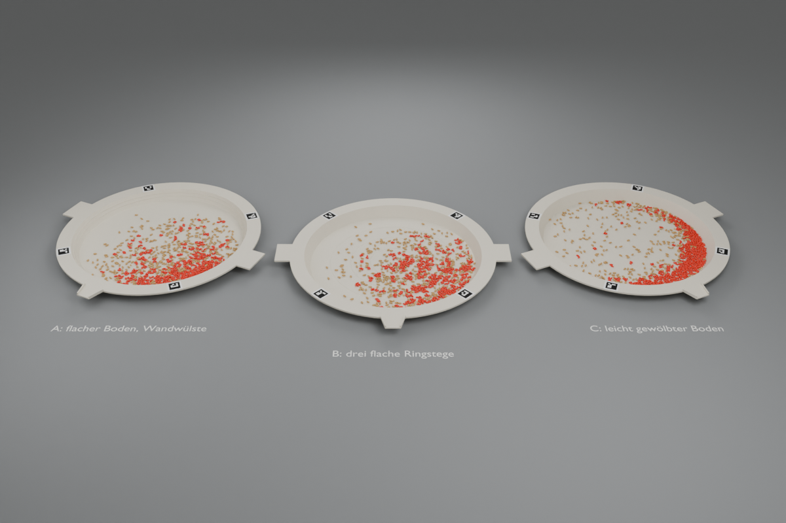

# Kornwaschpfanne: drei Prototypen und Schwenk-Simulation

Idee (Jonas): statt Klappstation eine flache runde Pfanne wie beim Goldwaschen. Die ganze
zufällige Handvoll kommt hinein, wird ein paar Sekunden geschwenkt und **in der Pfanne**
fotografiert. Erhofft: das Schwenken löst Haufen auf (größter Zählfehler: Körner, die sich
berühren), sortiert vielleicht nach Gewicht oder Größe in Ringe und ist ein einziges,
abwaschbares Teil. Die Stichprobe bleibt zufällig, solange nichts aussortiert wird; Umordnen
ist erlaubt, Auswählen nicht.



## Astras Physik-Einschätzung (GPT-6 Astra via Codex, 27.10.2026)

Designantwort: [`ASTRA_DESIGN.md`](ASTRA_DESIGN.md).

- **Gewichtssortierung ist ein Mythos.** Eine kreisend bewegte (nicht rotierende) Pfanne
  erzeugt im Pfannensystem eine umlaufende, überall gleiche Trägheitskraft, kein
  Zentrifugalfeld. Reibung und Trägheit skalieren beide mit der Masse: schwere Körner
  wandern nicht früher nach außen.
- Realistisch in 10–20 s: der Haufen fällt zusammen und verteilt sich, an der Wand können
  sich Körner sammeln, Bruch und Spreu reichern sich vielleicht schwach an. Saubere
  Gewichtsklassen oder Größenringe sind nicht zu erwarten.
- Schwenkbewegung von Hand: 15–25 mm Kreisradius, 2–3 Hz. Bei 20 mm und 2,5 Hz sind das
  0,5 g; erst oberhalb von etwa µ·g (Weizen auf PP µ ≈ 0,45) rutschen die Körner, bei
  kleinen Kreisen fährt der Haufen nur mit.
- Rillen sind riskant: in Kreisrillen legen sich Körner Spitze an Spitze (neue Kontakte),
  und Stege werfen Schatten.
- Urteil: **KornKlapp bleibt die Abgabe für heute.** Die Pfanne ist ein Kandidat für ein
  späteres Produkt, aber nur, wenn echte Versuche weniger Kontakte ohne Kornverlust zeigen.

> Pitch-Satz (Astra): „Die Kornpfanne soll die ganze Handvoll mit wenigen Kreisbewegungen
> fürs Foto verteilen und anschließend vollständig in den Wiegebecher bringen.“

## Drei Prototypen (Astras Spec, mm)

Gemeinsam: Boden Ø290 (A4-Fläche), Wand 10 mm breit und 20 mm hoch (63°), Randflansch bis
Ø360, Boden 3 mm, Wand 2 mm, mattes Elfenbein-PP (Prototyp PETG). Zwei Griffe 50 × 25 × 3
bei 90°/270°, Ausgießlippe bei 0° (25 lang, 40 → 25 breit, 3 mm Seitenleisten). Vier
ArUco-Marker DICT_4X4_50 (IDs 0–3, 18 mm + 3 mm Rand) auf dem Flansch bei r = 167,5 und
45°/135°/225°/315°. Da sie 20 mm über dem Boden liegen, braucht die App die Kamerapose und
nicht einfach eine Homographie (sonst ca. 5 % Maßstabsfehler).

| Prototyp | Geometrie | Hypothese | Wann verworfen |
|---|---|---|---|
| **A**: flacher Boden, Wandwülste | zwei Wülste r 0,75 an der Wand bei (r, z) = (149, 8) und (152, 14) | Wülste bremsen den Umlauf, der Fotoboden bleibt frei | keine Verbesserung gegenüber glatter Pfanne, oder Körner bleiben an den Wülsten hängen |
| **B**: drei flache Ringstege | Stege bei r = 40/75/110, 3 breit, 0,6 hoch, Kosinusprofil | schwache Barrieren verteilen auf Zonen | mehr Kontakte als A, Ketten entlang der Stege |
| **C**: leicht gewölbter Boden | z = 2·(1 − (r/145)²), Mitte 2 mm höher, max. 1,6° | sanfter Drang nach außen ohne Rillen | Gedränge am Rand, mehr Kontakte als A |

Detailansichten sind aus Größengründen nicht enthalten; Quellen und STL-Dateien bleiben erhalten.

## Simulation

Blender 5.0 / Bullet, 880 Teilchen wie eine echte Handvoll: 792 ganze Weizenkörner
(6,6 × 3,3 × 2,8 mm), 53 Bruchhälften, 35 Spreuplättchen. Die Handvoll fällt als Haufen in
die Mitte, dann 8 s Schwenken mit 20 mm Kreisradius bei 2,5 Hz (0,5 g), dann 1,5 s Ruhe.
Physik nach Astras Startwerten (Weizen–PP µ ≈ 0,36, Weizen–Weizen µ ≈ 0,36, 600 Schritte/s).
„Berührt“ heißt: Umrisse im Foto von oben weniger als 0,2 mm auseinander.

| Lauf | berührt | gestapelt | Median-Radius Korn | Median-Radius Bruch |
|---|---:|---:|---:|---:|
| A4-Blatt, nur hingeschüttet | 96 % | 26 % | 36 mm | 42 mm |
| **Zufällig gestreut** (Bezug, gleiche Dichte, ohne Physik) | **10–14 %** | 0 | – | – |
| Glatte Pfanne (Kontrolle) | 59 % | 0 | 95 mm | 129 mm |
| A: Wandwülste | 54 % | 0 | 96 mm | 134 mm |
| A mit Richtungswechsel + 3° Kippeln | 58 % | 0 | 127 mm | 138 mm |
| A mit sanftem Auslaufen (4 s) | 63 % | 0 | 78 mm | 92 mm |
| B: Ringstege | 56 % | 0 | 91 mm | 123 mm |
| C: gewölbter Boden | 61 % | 0 | 122 mm | 139 mm |

Zwei Läufe mit gleichem Startwert streuen um etwa ±4 Prozentpunkte (Bullet ist nicht
deterministisch). Es gibt je einen Lauf pro Variante, Astra empfiehlt mindestens zehn.

Simulationsframes und Verlaufsbilder sind aus Größengründen nicht enthalten. Die
Tabelle bewahrt die damaligen Messwerte; mit `simulate.py` lassen sich neue Läufe erzeugen.

**Was die Simulation zeigt**

1. **Schwenken löst den Haufen auf**: keine gestapelten Körner mehr, Berührungen fallen von
   96 % auf etwa 55–60 %. Das ist ein echter Gewinn gegenüber einfachem Hinschütten.
2. **Es trennt die Körner aber nicht**: zufälliges Streuen gleicher Dichte ergäbe nur
   10–14 % Berührungen. Beim Schwenken bilden sich Ketten und Paare, und beim Anhalten
   wirft der Schwung die Körner in einen Sektor der Pfanne, wo sie sich drängen
   (Bild Mitte). Wie man aufhört, prägt das Endbild stärker als jede Rille.
3. **Rillen, Stege und Wölbung ändern nichts Messbares**: A, B, C und die glatte Pfanne
   liegen innerhalb der Streuung. Ein sanftes Auslaufen verteilt weniger, ein
   Richtungswechsel drückt alles an den Rand.
4. **Bruch wandert nach außen**: In allen sechs Pfannenläufen liegt der Median der
   Bruchhälften 10–40 mm weiter außen als der der ganzen Körner. Das ist die einzige
   Sortierung, die sich zeigt, und sie passt zu Astras Vorhersage (kleine, kantige Teile
   rollen anders). Für die App wäre ein „Bruchring“ an der Wand ein Hinweis, kein Sieb.
5. **Gewichtssortierung**: nicht beobachtet, wie von Astra vorhergesagt.

**Grenzen**: starre konvexe Körper, keine Luft, kein Staub, keine echte Rollreibung. Die
Spreu verschwindet teilweise durch den Boden (dünne 0,3-mm-Plättchen tunneln in Bullet);
die Spreu-Zahlen sind daher nicht belastbar. Die Handarbeit mit dem KornKlapp-Spatel ist
nicht simuliert. Alle Aussagen brauchen einen echten Versuch mit Weizen.

**Fazit**: Die Pfanne ist ein guter erster Schritt (Haufen weg in 8 s, ohne Werkzeug),
aber kein Ersatz fürs Auseinanderschieben. Für den Pitch taugt sie als Ausblick
„einfaches Werkzeug, Schwenken statt Zählen“, nicht als Genauigkeitsversprechen. Nächste
Hypothese, falls es weitergeht: ein feiner Noppenboden mit deutlich mehr Mulden als
Körnern (etwa 3000 flache Mulden für 800 Körner). Er wählt nichts aus, unterbricht aber
Ketten. Oder einfach: schwenken, dann mit dem Spatel die roten Stellen nacharbeiten,
die die App markiert.

## Dateien

| Datei | Inhalt |
|---|---|
| `designs.py` | Profile der Pfannen und Schwenkbewegungen (eine Quelle für CAD und Simulation) |
| `simulate.py` | Bullet-Starrkörpersimulation in Blender, Metriken, Kornposen |
| `random_baseline.py` | Bezug: zufällig gestreute Körner gleicher Dichte |
| `build_pfannen.py` | CAD, STL, GLB, Renders; `--contacts` färbt berührende Körner rot |
| `out/stl/pfanne_{A,B,C}.stl` | Pfannenkörper mit Griffen und Lippe (Marker als Aufkleber) |
| `build_pfannen.py`, `designs.py` | Szene regenerieren; BLEND-Export mit privaten Pfaden nicht enthalten |
| `simulate.py` | Simulation regenerieren; Frames/JSON-Exporte nicht mitgeliefert |

```bash
B="C:/Program Files/Blender Foundation/Blender 5.0/blender.exe"
"$B" --background --python-exit-code 1 --python hardware/waschpfanne/simulate.py -- --design A --n 880 --seconds 11
"$B" --background --python-exit-code 1 --python hardware/waschpfanne/build_pfannen.py -- --contacts
```
